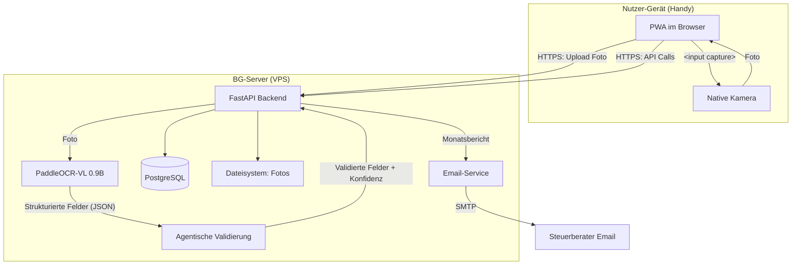
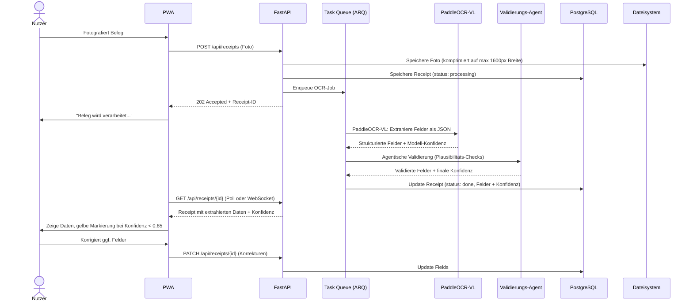
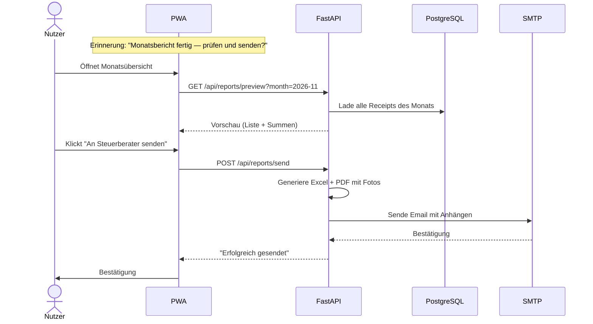
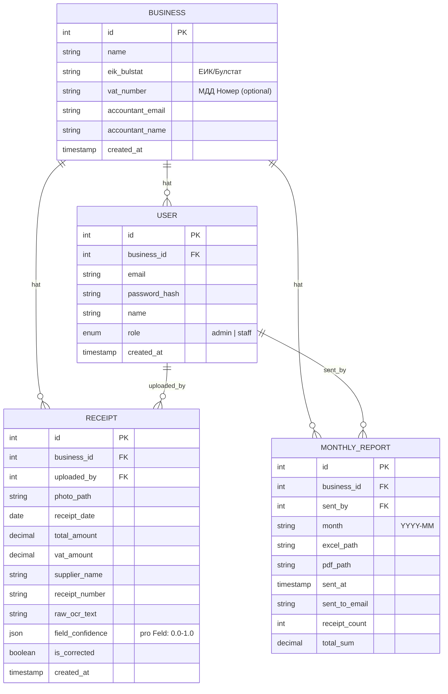
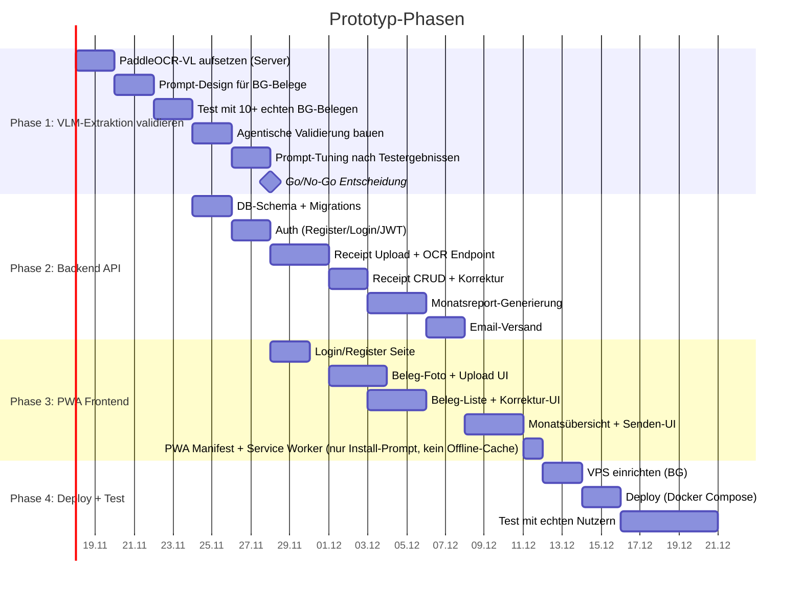
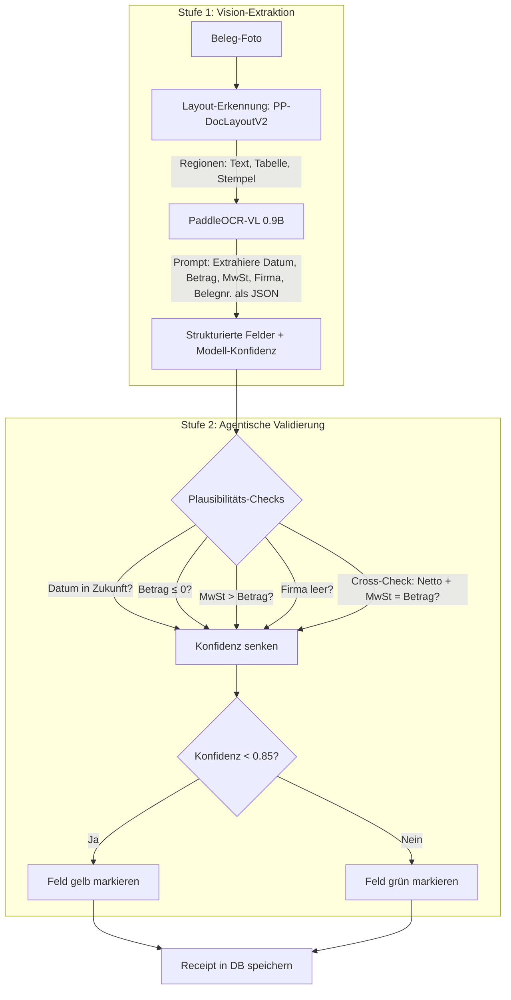

# Prototyp: Beleg-Scanner App für Bulgarien

## Ziel

Ein funktionierender Prototyp, der den kompletten Flow abdeckt:
Beleg fotografieren → OCR-Extraktion → Daten speichern → Monatsübersicht → Email an Steuerberater.

**Reihenfolge**: OCR-Validierung zuerst (technisches Hauptrisiko), dann Rest drum herum.

## Nicht-Ziele (MVP)

- Kein App Store Release (PWA reicht)
- Kein Multi-Betrieb pro Nutzer
- Kein Steuerberater-Portal
- Keine Offline-Funktionalität
- Keine Integration in Buchhaltungssoftware
- Kein Englisch/Deutsch (nur Bulgarisch)

## Systemarchitektur



## Request-Flow: Beleg hochladen

OCR läuft **asynchron** — ein Budget-VPS ohne GPU braucht 5–30s pro Bild. Synchrones Verarbeiten würde zu Timeouts führen.



## Monatsexport-Flow



## Datenmodell



## Tech-Stack

| Komponente | Technologie | Begründung |
|---|---|---|
| Frontend | PWA (HTML/CSS/JS, Vanilla oder Alpine.js) | Daniela kennt Web, kein neues Framework nötig |
| Backend | Python 3.12 + FastAPI | Daniela kennt Python/Flask, FastAPI ist moderner |
| Vision-Modell | PaddleOCR-VL 1.5 (0.9B, server-seitig) | Vision-Language-Modell: versteht Beleg-Layout, extrahiert Felder direkt als JSON, läuft auf CPU, Apache 2.0 |
| Validierung | Agentische Plausibilitäts-Pipeline | Regelbasierte Checks + Cross-Field-Validierung, kein LLM nötig |
| Datenbank | PostgreSQL | Robust, kostenlos, JSON-Support für Konfidenz-Daten |
| Task Queue | ARQ (async, Redis-basiert) | Leichtgewichtig, Python-nativ, für OCR-Jobs |
| Email | Python `smtplib` + `email` | Standardbibliothek, kein externer Service nötig |
| Excel-Export | `openpyxl` | Python-Lib, unterstützt Formatierung (gelbe Zellen) |
| PDF-Export | `reportlab` oder `weasyprint` | Fotos einbetten, tabellarische Übersicht |
| Hosting | BG VPS (SuperHosting.bg o.ä.) | Daten in Bulgarien, niedrige Latenz |
| Auth | `passlib` + `python-jose` (JWT) | Bewährt, leichtgewichtig |

## Implementierungsreihenfolge



## Extraktions-Pipeline (Design)

Statt klassisches OCR + Regex nutzt die Pipeline ein **Vision-Language-Modell** (VLM), das den Beleg als Bild versteht und direkt strukturierte Felder extrahiert — gefolgt von einer **agentischen Validierungsstufe**.

### Warum VLM statt OCR + Regex?

| Ansatz | Problem |
|---|---|
| Tesseract / Surya + Regex | Fragil: Jedes Beleg-Layout braucht eigene Regex. Kyrillisch + gemischte Formate → hohe Fehlerrate. Kein semantisches Verständnis. |
| **PaddleOCR-VL 1.5 (VLM)** | Versteht Layout + Inhalt gemeinsam. Extrahiert Felder direkt als JSON. 0.9B Parameter → läuft auf CPU. 94.5% auf Document-Benchmarks. Receipt-Finetune verfügbar. |

### 2-Stufen-Pipeline



### Stufe 1: PaddleOCR-VL — Prompt-basierte Extraktion

Das VLM bekommt das Foto und einen strukturierten Prompt:

```
OCR: Extrahiere aus diesem bulgarischen Kassenbon folgende Felder als JSON:
- datum (Format: YYYY-MM-DD)
- betrag (Gesamtbetrag in BGN, Zahl)
- mwst (MwSt-Betrag in BGN, Zahl)
- lieferant (Firmenname)
- belegnummer (Belegnummer oder Fiskalbonnummer)

Antworte NUR mit dem JSON-Objekt.
```

Das Modell versteht den visuellen Kontext (wo steht der Betrag? Was ist die Überschrift?) und liefert direkt strukturierte Daten — kein Umweg über Rohtext.

### Stufe 2: Agentische Validierung

Regelbasierte Pipeline, die jedes Feld prüft und die Konfidenz anpasst:

| Regel | Prüfung | Bei Verstoß |
|---|---|---|
| Datum-Plausibilität | Liegt in Vergangenheit, nicht älter als 2 Jahre | Konfidenz −0.3 |
| Betrag-Plausibilität | > 0, < 100.000 BGN | Konfidenz −0.5 |
| MwSt-Konsistenz | MwSt ≤ Betrag, MwSt ≈ 20% oder 9% von Netto | Konfidenz −0.2 |
| Cross-Field-Check | Netto + MwSt ≈ Betrag (±0.02 BGN Toleranz) | Konfidenz −0.3 |
| Firma nicht leer | Mindestens 2 Zeichen | Konfidenz −0.5 |
| Belegnummer-Format | Enthält Ziffern | Konfidenz −0.1 |

**Finale Konfidenz** = Modell-Konfidenz × Produkt der Regel-Faktoren. Schwelle für gelbe Markierung: **< 0.85**.

### Fallback-Strategie

Wenn PaddleOCR-VL bei bestimmten Beleg-Typen versagt (Phase-1-Tests):
1. **Erst**: Prompt-Tuning (andere Formulierung, Beispiele im Prompt)
2. **Dann**: Receipt-spezifisches Finetuning des Modells (WildReceipt-Dataset existiert)
3. **Notfalls**: Für hartnäckige Fälle optional einen Cloud-VLM-API-Call (Qwen/Claude Vision), pay-per-use nur bei Konfidenz < 0.5 — ca. 0.01–0.03 BGN pro Beleg

### Hardware-Anforderungen

| Komponente | Minimum | Empfohlen |
|---|---|---|
| RAM | 4 GB | 8 GB |
| CPU | 2 Kerne | 4 Kerne |
| Disk | 20 GB | 50 GB |
| GPU | Nicht nötig | Nicht nötig |
| Modellgröße | ~1.8 GB (VLM + Layout) | ~1.8 GB |
| Inferenz-Zeit/Bild | ~5–15s (CPU) | ~3–8s (4 Kerne) |

## Phase 1: VLM-Extraktion validieren (Detail)

Das ist der Prototyp-Killer. Wenn die Feld-Extraktion bei bulgarischen Belegen nicht funktioniert, ist alles andere hinfällig.

### Bildvorverarbeitung

Vor der Extraktion: Foto wird auf max. 1600px Breite komprimiert. PaddleOCR-VL enthält bereits eine Layout-Erkennung (PP-DocLayoutV2), die Rotation und Segmentierung handhabt. Falls Phase-1-Tests zeigen, dass zusätzliche Vorverarbeitung nötig ist (z.B. bei extremer Schräglage), wird OpenCV-Preprocessing evaluiert.

### Testprotokoll

| # | Testfall | Erfolgskriterium |
|---|---|---|
| 1 | Kassenbon aus Supermarkt (thermisch) | Datum, Betrag, Firma >85% korrekt |
| 2 | Kassenbon von Lieferant (Druck) | Alle 5 Pflichtfelder extrahiert |
| 3 | Handschriftliche Quittung | ⚠️ Informational — NICHT im Go/No-Go Durchschnitt (VLM primär für gedruckten Text) |
| 4 | Schlechte Beleuchtung / schräg | Ergebnis nicht deutlich schlechter als #1 |
| 5 | Gemischter Text (Kyrillisch + Latein) | Beide Schriften korrekt erkannt |
| 6 | Verblasster Thermobon | Mindestens Betrag erkennbar |
| 7 | Lieferantenrechnung (A4, gedruckt) | Alle Felder >90% korrekt |
| 8 | Bon mit QR-Code (НАП) | Text um QR herum korrekt, QR ignoriert |
| 9 | Kleiner Kiosk-Bon (schmal) | Betrag + Datum erkennbar |
| 10 | 10 Belege Batch-Test | Durchschnitt >80% Feldgenauigkeit |

### Go/No-Go Kriterien

- **Go**: Durchschnittliche Feldgenauigkeit ≥80% über 9 gedruckte Belege (Test #3 Handschrift ist informational, nicht im Durchschnitt)
- **Pivot**: 60–80% → Server-seitige Nachbearbeitung mit Regex/Heuristiken evaluieren
- **No-Go**: <60% → Cloud-VLM-API (Qwen/Claude Vision) als primäres Modell evaluieren, Kostenrechnung machen

## API-Endpunkte

| Methode | Pfad | Beschreibung | Auth |
|---|---|---|---|
| POST | `/api/auth/register` | Neuen Betrieb + Admin anlegen (Rate Limit: 5/h) | - |
| POST | `/api/auth/verify-email` | Email-Adresse bestätigen (Token aus Email) | - |
| POST | `/api/auth/login` | JWT Token erhalten (nur nach Verifizierung) | - |
| POST | `/api/auth/invite` | Mitarbeiter einladen (Link generieren) | Admin |
| POST | `/api/receipts` | Beleg-Foto hochladen + OCR | Admin/Staff |
| GET | `/api/receipts` | Belege auflisten (Filter: Monat) | Admin/Staff |
| GET | `/api/receipts/{id}` | Einzelner Beleg mit Daten + Foto-URL | Admin/Staff |
| PATCH | `/api/receipts/{id}` | Felder korrigieren | Admin/Staff |
| DELETE | `/api/receipts/{id}` | Beleg löschen | Admin |
| GET | `/api/reports/preview` | Monatsvorschau | Admin |
| POST | `/api/reports/send` | Monatsbericht per Email senden | Admin |
| GET | `/api/reports` | Gesendete Berichte auflisten | Admin |
| GET | `/api/business` | Betriebsdaten | Admin |
| PATCH | `/api/business` | Betriebsdaten ändern (Steuerberater-Email) | Admin |

## PWA-Seiten

| Seite | Route | Beschreibung |
|---|---|---|
| Login | `/login` | Email + Passwort |
| Registrierung | `/register` | Betrieb + Admin anlegen |
| Dashboard | `/` | Monatsübersicht, letzte Belege, Quick-Upload |
| Beleg erfassen | `/scan` | Kamera öffnen, Foto machen, extrahierte Daten prüfen |
| Beleg-Liste | `/receipts` | Alle Belege des aktuellen Monats, Filter |
| Beleg-Detail | `/receipts/:id` | Foto + Daten + Korrektur |
| Monatsbericht | `/report` | Vorschau + "An Steuerberater senden" |
| Einstellungen | `/settings` | Steuerberater-Email, Mitarbeiter einladen |

## Excel-Format (Monatsexport)

| Spalte | Format | Hinweis |
|---|---|---|
| Nr. | Laufnummer | |
| Datum | TT.MM.JJJJ | |
| Lieferant | Text | |
| Belegnummer | Text | |
| Betrag (BGN) | Zahl, 2 Dezimal | |
| davon MwSt (BGN) | Zahl, 2 Dezimal | |
| Netto (BGN) | Berechnet | |
| Status | "geprüft" / "ungeprüft" | Gelb = ungeprüft |

**Fußzeile**: Summe Betrag, Summe MwSt, Summe Netto, Anzahl Belege

**Gelbe Markierung**: Zellen mit OCR-Konfidenz <0.85 werden gelb hinterlegt.

**Anhang**: Fotos werden bei Upload auf max. 1600px Breite komprimiert (~200–400KB pro Bild). Bei ≤20 Belegen: alle Fotos als ein PDF eingebettet. Bei >20 Belegen oder Gesamtgröße >15MB: Email enthält nur die Excel-Tabelle + einen zeitlich begrenzten Download-Link (72h) für das Foto-Archiv.

## Sicherheit

| Maßnahme | Umsetzung |
|---|---|
| Transport | HTTPS (Let's Encrypt) |
| Auth | JWT mit Ablauf (24h), Refresh-Token |
| Passwörter | bcrypt via `passlib` |
| Foto-Upload | Dateityp-Validierung, Max 10MB, kein Pfad-Traversal |
| SQL Injection | SQLAlchemy ORM / Parameterized Queries |
| XSS | Keine Template-Engine im Backend (reine API), Frontend: DOM-Sanitizing |
| DSGVO | Daten in BG, Löschrecht implementiert, kein Tracking |
| Rate Limiting | FastAPI Middleware, max 100 Uploads/Stunde/Nutzer |

## Offene Fragen (vor Launch zu klären)

1. **Steuerberaterin als Fachberaterin** — finale Feldliste validieren, insbesondere: Braucht sie MwSt aufgeschlüsselt nach Sätzen (20%/9%)? Im Prototyp ist es ein einzelnes Feld.
2. **Rechtlich**: Ist ein Foto ein gültiger Beleg-Ersatz, oder muss das Original aufbewahrt werden?
3. **OCR Go/No-Go** — Phase 1 muss bestehen
4. **VPS-Anbieter** — konkreten bulgarischen Hoster auswählen und Kosten klären
5. **Email-Zustellbarkeit** — eigener SMTP vs. Dienst wie Mailgun (SPF/DKIM nötig)
6. **Backup-Strategie** — für Prototyp akzeptabel ohne, vor Launch: automatische tägliche Backups oder S3-kompatibler Object Storage für Fotos

## Decisions

- 2026-11-11 (Challenge Round): Email-Anhang-Größe begrenzt — Fotos bei Upload komprimiert, bei >20 Belegen oder >15MB wird ein Download-Link statt Anhang verwendet. Grund: SMTP-Limit 25MB, Monat mit 50+ Belegen würde sonst bounced.
- 2026-11-11 (Challenge Round): OCR läuft asynchron über Task Queue (ARQ). Grund: Surya auf CPU-VPS braucht 5–30s pro Bild, synchron = Timeout.
- 2026-11-11 (Planänderung): Surya OCR + Regex ersetzt durch PaddleOCR-VL 1.5 (0.9B Vision-Language-Modell) + agentische Validierung. Grund: Reine OCR + Regex ist zu fragil für die Vielfalt bulgarischer Beleg-Layouts. Ein VLM versteht Layout + Inhalt gemeinsam und extrahiert Felder direkt als JSON. PaddleOCR-VL läuft auf CPU (0.9B params), 94.5% auf Document-Benchmarks, Apache 2.0, Receipt-Finetune verfügbar.
- 2026-11-11 (Challenge Round): Handschriftliche Belege aus Go/No-Go-Durchschnitt entfernt (informational only). Grund: Surya ist für Druck trainiert, Handschrift würde den Durchschnitt unfair drücken.
- 2026-11-11 (Challenge Round): Email-Verifikation bei Registrierung + Rate Limiting. Grund: Ohne wäre der Report-Endpunkt ein offener Email-Relay.
- 2026-11-11 (Challenge Round): Einzelner MwSt-Betrag im Prototyp akzeptiert. Aufschlüsselung nach MwSt-Sätzen (20%/9%) wird mit Steuerberaterin geklärt (Offene Frage #1). Grund: Prototyp-Scope, Feld-Erweiterung ist datenmodell-kompatibel über JSON.
- 2026-11-11 (Challenge Round): Service Worker nur für PWA-Install-Prompt, kein Offline-Cache. Grund: Offline ist explizites Non-Goal.
- 2026-11-11: Beide Vertriebskanäle (Direkt + Steuerberater) bleiben offen; finales Preismodell erst nach Prototyp-Validierung. Grund: Nebenprojekt, Markt erst testen.
- 2026-11-11: OCR zuerst validieren, bevor Rest des Flows gebaut wird. Grund: Technisches Hauptrisiko; bei Scheitern wäre Rest verschwendet.
- 2026-11-11: PWA statt native App. Grund: Entwicklerin kommt aus Web, schnellster Weg zum Prototyp, kein App Store nötig.
- 2026-11-11: Eigener BG-Server statt Cloud-API. Grund: Datenschutz-Priorität, keine laufenden API-Kosten, Daten bleiben in Bulgarien.
- 2026-11-11: ~~Surya OCR statt Tesseract~~ → Ersetzt durch PaddleOCR-VL (siehe Planänderung oben).
- 2026-11-11: Halbautomatischer Email-Versand mit Erinnerung. Grund: Nutzer behält Kontrolle, vermeidet unvollständige Reports.
- 2026-11-11: Admin/Staff Rollensystem. Grund: Mehrere Nutzer pro Betrieb, Angestellte sollen nicht löschen/senden können.
